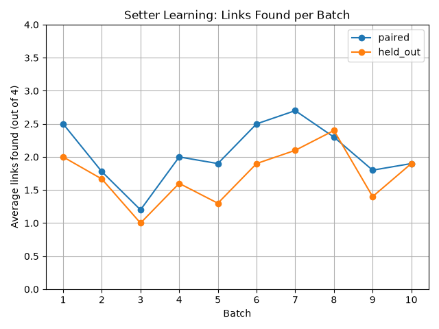

# CONNECTION

A word-chain game where one AI hides a chain of linked words and another AI tries to follow it. I built a loop where the setter studies its mistakes and rewrites its own strategy after every batch of games. Then I tested whether it actually got better.

I demoed this at AI Tinkerers NYC Agentic Loops Demo Day on October 21, 2026.

## How the game works

The board has 16 words. The setter picks a starting clue that is not on the board, then hides a chain of 4 board words. Each word should connect to the one before it.

The guesser sees the board and the starting clue. It picks the board word it thinks comes next.

- A correct guess reveals that word as the next clue.
- A wrong guess costs one of 3 lives.
- A word that is not on the board, or was already used, costs nothing.
- The game ends when the guesser finishes the chain or runs out of lives.

## The self-play loop

1. Every game gets a new random board from a pool of common words.
2. The setter (Claude Haiku) builds a chain for that board, guided by its current strategy notes.
3. Two guessers play the same chain. The paired guesser is also Claude Haiku. The held-out guesser is GPT-5 mini.
4. After each batch of 10 games, the setter reviews how the paired guesser did, including what it guessed instead at each missed link and why. It rewrites its strategy notes in 150 words or fewer.
5. The held-out guesser's results never go back into the loop. It measures whether the setter is getting clearer in general or only easier for a model like itself to read.

Every game is logged to `game_logs.jsonl`, and every version of the strategy notes is saved to `strategy_notes_history.jsonl`.

## What I found

| Setup | Games per guesser | Chains completed (paired) | Chains completed (held-out) | Links found by held-out guesser (of 4) |
| --- | --- | --- | --- | --- |
| Haiku setter, thinking off, 10 batches | 99 | 19% | 10% | 1.73 |
| Haiku setter, thinking on, 4 batches | 37 | 54% | 43% | 2.59 |

**The strategy notes didn't help.** Across 10 batches, the held-out guesser found 2.00 links per chain in batch 1 and 1.90 in batch 10. The paired guesser went from 2.50 to 1.90.

**Turning on thinking did.** Enabling the setter's extended thinking was a one-line change. In a separate run, the held-out guesser found 2.59 links per chain, up from 1.73.

**The notes and the chains didn't always match.** In one game the setter wrote "Strategy notes say EVEREST->HORSE was a missed loose link, so this chain avoids it." Then it used that link anyway.



*Links found per batch in the 10-batch run with thinking off. Neither guesser trends upward.*

I also ran GPT-5 mini as the setter. It completed 57% of chains, but its held-out guesser was the same model as the setter, so that run doesn't test the same thing.

## Limits

- I ran each setup once. These are first results, not conclusions.
- The thinking run had 4 batches, not 10, so it was too short to show whether the notes help once thinking is on.
- The boards are random, so some are harder than others. Batch-to-batch changes include that noise.

## Next steps

- Repeat each setup several times to see how much results vary.
- Use separate training and test boards, so the notes are judged on boards the setter never learned from.
- Try changes to how the setter writes and uses its notes.

## Running it

You need Python 3 and API keys for Anthropic and OpenAI.

```bash
pip install anthropic openai python-dotenv matplotlib
```

Create a `.env` file in the project folder.

```text
ANTHROPIC_API_KEY=your_key_here
OPENAI_API_KEY=your_key_here
```

| Command | What it does |
| --- | --- |
| `python play_in_terminal.py` | Play one game yourself in the terminal |
| `python test_connection_rules.py` | Check the game rules (prints PASS or FAIL for each step) |
| `python run_self_play_batches.py` | Run the self-play experiment (models, thinking, batches and games per batch are set at the top of the file) |
| `python analyze_results.py` | Summarize the latest run and save `links_found_by_batch.png` |
| `python demo.py` | Build `demo.html`, the offline demo page, from the logs |

## Files

| File | What it is |
| --- | --- |
| `connection_rules.py` | Game state, guesses, lives and outcomes |
| `board_builder.py` | Random boards and chain validation |
| `word_pool.py` | The words boards are drawn from |
| `setter_agent.py` | Builds chains and rewrites the strategy notes |
| `guesser_agent.py` | Picks the next word and explains why |
| `play_one_agent_game.py` | Plays one game between a chain and an AI guesser |
| `run_self_play_batches.py` | The full experiment loop |
| `analyze_results.py` | Results by guesser and by batch, plus the chart |
| `demo.py` | Builds the demo page |
